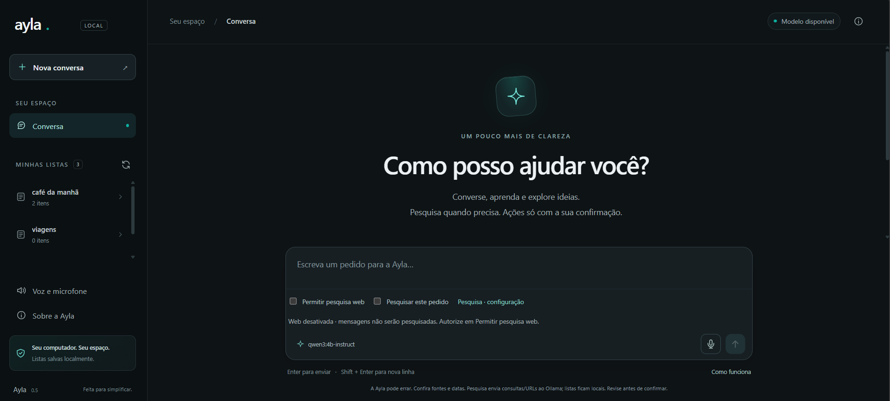
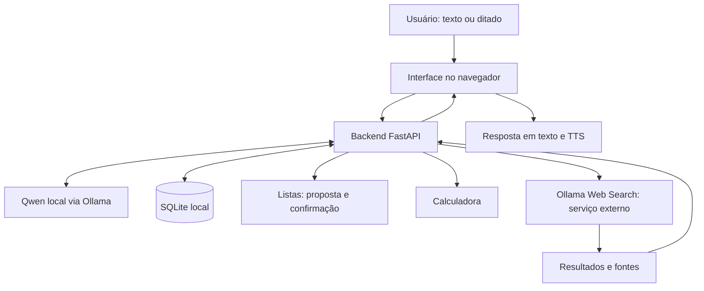

# Ayla

[](https://github.com/Tyago03/Ayla/actions/workflows/tests.yml)

**Assistente pessoal local com Qwen, ferramentas práticas e interface web.**

A Ayla reúne conversa geral, listas com confirmação, calculadora, pesquisa na internet e interação por voz. O modelo Qwen roda localmente pelo Ollama; o backend utiliza FastAPI e a persistência utiliza SQLite.

**Estado atual:** protótipo local de uso pessoal. A pesquisa web foi **testada manualmente pelo autor e funcionou após a adição de créditos à conta Ollama**. Antes disso, o serviço retornava HTTP 402 por falta de créditos. A seção [Testes e validação](#testes-e-validação) distingue o teste manual da pesquisa dos testes automatizados com serviços simulados.



## Recursos

| Recurso | Descrição |
| --- | --- |
| Conversa geral | Interação em linguagem natural com Qwen executado localmente via Ollama. |
| Listas com confirmação | Gerenciamento de listas por conversa, com confirmação das alterações propostas antes de aplicá-las. |
| Calculadora | Ferramenta para realizar cálculos solicitados durante a conversa. |
| Pesquisa web | Integração com Ollama Web Search para consultar informações externas e apresentar fontes. |
| Persistência local | Armazenamento dos dados da aplicação em SQLite. |
| Leitura em voz alta | Síntese de voz, ou TTS, pelos recursos disponíveis no navegador. |
| Ditado | Entrada por voz usando o modo local ou o reconhecimento do navegador, conforme a configuração. |
| Dark mode | Interface escura com fundo `#0E1315` e cor de destaque `#0DAD9E`. |

## Como funciona



O modelo interpreta a solicitação e participa da elaboração da resposta. As ferramentas executam as ações correspondentes; alterações em listas passam pelo fluxo de confirmação. Quando uma pesquisa é necessária, os resultados externos servem de contexto para a resposta com fontes.

## Tecnologias

- **Python e FastAPI:** backend e integração das funcionalidades.
- **Ollama e Qwen:** execução local do modelo de linguagem.
- **SQLite:** persistência em arquivo local.
- **Interface web:** interação pelo navegador e apresentação das respostas.
- **Recursos de voz do navegador e ditado local:** leitura e entrada por voz, conforme disponibilidade e configuração.
- **Ollama Web Search:** provedor externo de pesquisa na internet.

## Requisitos

- Windows para utilizar os scripts `.bat` distribuídos com o projeto.
- Python **3.10 ou superior** e dependências da aplicação instaladas no ambiente do projeto.
- [Ollama instalado](https://ollama.com/download) e em execução.
- Modelo Qwen baixado, com o mesmo nome e variante definidos na configuração da Ayla.
- Memória e espaço em disco compatíveis com o tamanho do modelo escolhido.
- Navegador atualizado. Os recursos de voz dependem do navegador, do sistema e das permissões de microfone.
- Para pesquisa web: internet, conta Ollama, chave de API válida e acesso liberado pelo provedor, incluindo créditos quando exigidos.

A execução local do modelo e o acesso à pesquisa são componentes diferentes. A API local do Ollama não exige a chave de pesquisa; a integração remota utiliza uma credencial da conta. Consulte a [documentação de autenticação do Ollama](https://docs.ollama.com/api/authentication).

## Executar no Windows

### 1. Clonar e instalar

Instale [Git](https://git-scm.com/downloads), [Python 3.10+](https://www.python.org/downloads/) e [Ollama](https://ollama.com/download). Abra o PowerShell e execute:

~~~powershell
git clone https://github.com/Tyago03/Ayla.git
cd Ayla
ollama pull qwen3:4b-instruct
.\INSTALAR_DEPENDENCIAS_AYLA.bat
~~~

O instalador cria a pasta local `.venv` e instala as dependências. Deixe o Ollama em execução. O modelo padrão é `qwen3:4b-instruct`; caso altere `AYLA_MODEL`, instale a variante correspondente e confira a compatibilidade com ferramentas.

### 2. Testar e iniciar

Na raiz do repositório:

~~~powershell
.\TESTAR_AYLA.bat
.\INICIAR_AYLA.bat
~~~

O iniciador sobe o servidor somente em `127.0.0.1` e abre o navegador no endereço local, normalmente `http://127.0.0.1:8000`. Mantenha a janela do servidor aberta; pressione `Ctrl+C` para encerrá-lo. **Não abra portas no roteador nem publique esse servidor diretamente na internet.**

Os testes automáticos usam substitutos simulados para serviços externos. Eles não validam, sozinhos, a precisão do Qwen ou o acesso web da sua conta.

### 3. Configurar a API de pesquisa (opcional)

A pesquisa na internet não usa uma chave do navegador: ela usa uma **chave da conta Ollama** no backend, além de créditos/acesso ao Ollama Web Search.

1. Gere uma chave na página oficial: [Ollama — API Keys](https://ollama.com/settings/keys).
2. Confira as condições de uso, os créditos e os limites da conta.
3. Na raiz do projeto, execute:

   ~~~powershell
   .\CONFIGURAR_PESQUISA_WEB_AYLA.bat
   .\VERIFICAR_PESQUISA_AYLA.bat
   ~~~

4. Cole a chave **somente no configurador local**, nunca no chat, no README ou no GitHub.
5. Na interface da Ayla, ative **Permitir pesquisa web**; use **Pesquisar este pedido** para exigir uma busca na próxima mensagem.

O configurador salva o segredo **fora do repositório** (`%LOCALAPPDATA%\Ayla\web-secret.json` no Windows). Se `OLLAMA_API_KEY` estiver definida como variável de ambiente, ela terá precedência. A aplicação utiliza `https://ollama.com/api/web_search`.

**Requisito de créditos:** inicialmente, o provedor retornou `HTTP 402` com a mensagem `Add usage credits to use web search`. **Após adicionar créditos à conta Ollama, o autor confirmou que a pesquisa web voltou a funcionar.** Outras instalações continuam sujeitas à disponibilidade, aos limites e aos créditos do provedor. Conversa local, calculadora e listas não exigem essa API.

### 4. Voz (opcional)

A leitura em voz alta usa vozes disponíveis no navegador/sistema. Para preparar o ditado local, encerre a Ayla e execute:

~~~powershell
.\ATIVAR_DITADO_LOCAL_AYLA.bat
~~~

O atalho instala bibliotecas e baixa um modelo separado de reconhecimento de fala. Há também ditado pelo navegador, cuja disponibilidade e privacidade dependem do serviço utilizado. Sempre revise o texto reconhecido antes de confirmar ações.

### 5. Outros atalhos úteis

- `DIAGNOSTICAR_AYLA.bat`: verifica o ambiente local.
- `AVALIAR_AGENTE_AYLA.bat`: exercita o agente com seu Qwen real e gera relatório para revisão humana.
- `AVALIAR_IA_AYLA.bat`: avalia a linha de base histórica de classificação de intenções.
- `VERIFICAR_PESQUISA_AYLA.bat`: verifica a API de pesquisa sem depender do Qwen, podendo consumir cota.

Para Linux/macOS, consulte também [as instruções do módulo](ayla_v2/README.md).

## Exemplos de uso

| Objetivo | Exemplo de solicitação |
| --- | --- |
| Conversar | “Explique a diferença entre uma API e uma interface gráfica.” |
| Organizar uma lista | “Adicione leite e café à minha lista de compras.” Depois, revise e confirme a proposta. |
| Calcular | “Quanto é 18% de 250?” |
| Pesquisar | “Pesquise a versão atual do Python e mostre as fontes.” |
| Usar voz | Ative o ditado para preencher a mensagem ou a leitura em voz alta para ouvir a resposta. |

Revise o texto reconhecido pelo ditado antes de confirmar uma ação. Para informações atuais, consulte também os links apresentados na pesquisa.

## Voz e funcionamento local

O Qwen e o banco SQLite executam localmente. Depois da preparação do ambiente e do download do modelo, esses componentes não dependem do serviço de pesquisa para funcionar.

- **TTS no navegador:** a disponibilidade de vozes varia por sistema e navegador. Uma voz pode usar um serviço local ou remoto, conforme a [documentação de síntese de voz](https://developer.mozilla.org/en-US/docs/Web/API/SpeechSynthesisVoice/localService).
- **Ditado local:** depende do mecanismo local e dos recursos instalados na configuração utilizada.
- **Ditado pelo navegador:** depende de compatibilidade e permissão de microfone. Algumas implementações enviam áudio a um serviço externo e precisam de internet, conforme a [documentação de reconhecimento de fala](https://developer.mozilla.org/en-US/docs/Web/API/SpeechRecognition).
- **Pesquisa web:** envia a consulta ao serviço externo do Ollama e exige conexão com a internet.

Por isso, o caráter local do modelo não significa que todos os recursos de voz e pesquisa operem offline. Evite incluir dados sensíveis nas consultas enviadas a serviços externos.

## Testes e validação

A suíte offline é executada automaticamente no **GitHub Actions com Python 3.12 e 3.13** ([ver workflow](.github/workflows/tests.yml)). O CI não precisa de chave de pesquisa nem de um modelo Ollama instalado. O resultado publicado do workflow deve ser verificado separadamente dos testes locais com IA real.

A suíte de software passou nos **cenários simulados** registrados durante o desenvolvimento, envolvendo persistência, confirmação de alterações, ferramentas, erros e respostas de provedores fictícios. A referência técnica [`ayla_v2/VALIDACAO.md`](ayla_v2/VALIDACAO.md) é um relatório **histórico da versão 0.5.3, anterior à limpeza dos arquivos de exportação**. A contagem atual de testes pode ser diferente: execute `TESTAR_AYLA.bat` na sua instalação para obter o resultado real desta revisão.

| Verificação | Situação |
| --- | --- |
| Testes automatizados offline com mocks | Executados em entregas anteriores; aprovados nos cenários relatados. |
| Persistência e confirmação das listas | Cobertas por testes automatizados com dados de teste; também exercitadas manualmente durante o desenvolvimento. |
| Pesquisa com fontes | Fluxo e tratamento de falhas testados com respostas simuladas. |
| Pesquisa real pela conta Ollama do autor | **Funcionamento confirmado manualmente pelo autor após adicionar créditos à conta.** Antes disso, a API retornava HTTP 402. Não foi medida uma taxa formal de precisão factual. |
| Qwen real, microfone e ditado | Exigem avaliação na máquina do usuário; não existe uma nota validada de precisão geral no repositório. |

Os números de testes da aplicação **não são uma taxa de acerto da IA**. Links de fontes não asseguram, por si sós, que cada afirmação foi comprovada. Avalie relevância, data e consistência dos resultados antes de utilizá-los como evidência no portfólio.

## Solução de problemas

| Sintoma | O que fazer |
| --- | --- |
| `ollama` não é reconhecido | Instale/inicie o Ollama e reabra o terminal. |
| Modelo não encontrado | Execute `ollama list` e `ollama pull qwen3:4b-instruct`, ou baixe o nome definido em `AYLA_MODEL`. |
| Falta o ambiente virtual | Execute `INSTALAR_DEPENDENCIAS_AYLA.bat` na raiz do clone. |
| Pesquisa retorna `WEB_HTTP_402` / `Add usage credits...` | Confira os créditos/limites da conta Ollama. Não significa que a busca tenha sido feita. |
| Falha de pesquisa sem código claro | Use `VERIFICAR_PESQUISA_AYLA.bat` e revise o código de diagnóstico, sem compartilhar a chave. |
| Chave nova não é utilizada | Verifique se a variável `OLLAMA_API_KEY` está sobrepondo a chave salva no configurador. |
| Ditado indisponível | Confira permissão de microfone, compatibilidade do navegador e modo local (Whisper). |
| Leitura em voz alta sem som | Confira as vozes disponíveis e a saída de áudio do navegador/sistema. |

Nunca desative a validação HTTPS para contornar erros de conexão.

## Estrutura de referência

~~~text
Ayla/
├── README.md
├── .gitignore
├── INICIAR_AYLA.bat
├── INSTALAR_DEPENDENCIAS_AYLA.bat
├── TESTAR_AYLA.bat
├── CONFIGURAR_PESQUISA_WEB_AYLA.bat
├── VERIFICAR_PESQUISA_AYLA.bat
├── ATIVAR_DITADO_LOCAL_AYLA.bat
├── ayla_v2/
│   ├── main.py                   # API FastAPI
│   ├── agent.py                  # Conversa e orquestração de ferramentas
│   ├── web_tools.py              # Busca e leitura de páginas
│   ├── service.py / storage.py   # Ações de listas e persistência
│   ├── static/                   # Interface web e identidade visual
│   ├── tests/                    # Testes automatizados
│   ├── requirements*.txt
│   └── data/                     # Criada localmente; ignorada pelo Git
└── docs/
    └── ayla-home.png            # Captura da interface
~~~

As ferramentas de diagnóstico e avaliação adicionais acompanham o projeto. Arquivos de execução local, bancos, logs, configurações pessoais e modelos baixados **não fazem parte do repositório**.

## Imagem de capa do README

Salve uma captura da página inicial com o nome **`ayla-home.png`**, dentro da pasta **`docs`**, na raiz do repositório. O caminho final deve ser exatamente:

```text
docs/ayla-home.png
```

A referência já está incluída no início deste README:

```markdown

```

Use uma captura legível, preferencialmente em 1440×900 ou 1920×1080. Oculte chaves, tokens de acesso, dados pessoais e conteúdo privado de conversas ou listas. Adicione a imagem ao mesmo repositório para que o GitHub consiga exibi-la.

## Segurança e publicação

Este repositório contém a **aplicação web atual**, não o aplicativo legado Ayla Mobile. O código é público, mas o servidor FastAPI foi pensado para uso local e **não implementa autenticação multiusuário**. Não publique sua porta HTTP ou o serviço Ollama na internet.

O arquivo `.gitignore` impede novos arquivos não rastreados das categorias abaixo de entrarem em commits comuns:

- Chaves de API, `web-secret.json` e `.env`.
- Banco SQLite, listas pessoais, resultados e relatórios locais.
- `.venv`, caches, backups, logs, gravações e pesos de modelos.

**Importante:** um `.gitignore` não remove informações de commits anteriores nem revoga credenciais expostas. Caso uma chave seja publicada, revogue/rotacione no provedor e trate o histórico separadamente.

Leia [`ayla_v2/README.md`](ayla_v2/README.md) para detalhes da arquitetura e dos limites de ferramentas. Desenvolvimento assistido por IA; os modelos-base, APIs e dependências são projetos de terceiros.

## Contribuições

Sugestões e relatos de problemas podem ser registrados nas issues do repositório. Descreva como reproduzir o comportamento, o modelo utilizado e o ambiente, sem incluir credenciais ou dados pessoais. Alterações em ferramentas devem preservar o fluxo de confirmação e receber a validação apropriada.

## Autor

**Tyago Vitorino Ferreira** — bacharel em Ciência da Computação e estudante de Cibersegurança.

Ayla é um projeto de portfólio voltado à integração de modelos locais, ferramentas, persistência e interface web.
