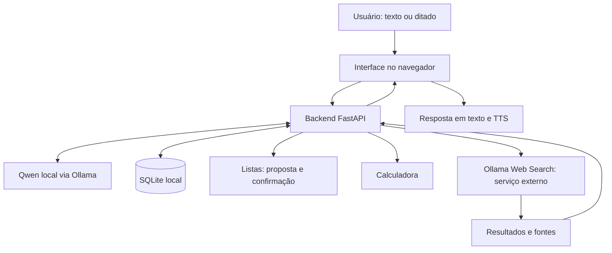

# Ayla

**Assistente pessoal local com Qwen, ferramentas práticas e interface web.**

A Ayla reúne conversa geral, listas com confirmação, calculadora, pesquisa na internet e interação por voz. O modelo Qwen roda localmente pelo Ollama; o backend utiliza FastAPI e a persistência utiliza SQLite.

**Estado atual:** os recursos descritos estão funcionais no ambiente local do autor, incluindo a pesquisa web, testada com sucesso após a adição de créditos à conta do provedor. A seção [Testes e validação](#testes-e-validação) detalha os testes automatizados e a verificação manual.


## Recursos

| Recurso | Descrição |
| --- | --- |
| Conversa geral | Interação em linguagem natural com Qwen executado localmente via Ollama. |
| Listas com confirmação | Gerenciamento de listas por conversa, com confirmação das alterações propostas antes de aplicá-las. |
| Calculadora | Ferramenta para realizar cálculos solicitados durante a conversa. |
| Pesquisa web | Integração com Ollama Web Search para consultar informações externas e apresentar fontes. |
| Persistência local | Armazenamento dos dados da aplicação em SQLite. |
| Leitura em voz alta | Síntese de voz, ou TTS, pelos recursos disponíveis no navegador. |
| Ditado | Entrada por voz usando o modo local ou o reconhecimento do navegador, conforme a configuração. |
| Dark mode | Interface escura com fundo `#0E1315` e cor de destaque `#0DAD9E`. |

## Como funciona



O modelo interpreta a solicitação e participa da elaboração da resposta. As ferramentas executam as ações correspondentes; alterações em listas passam pelo fluxo de confirmação. Quando uma pesquisa é necessária, os resultados externos servem de contexto para a resposta com fontes.

## Tecnologias

- **Python e FastAPI:** backend e integração das funcionalidades.
- **Ollama e Qwen:** execução local do modelo de linguagem.
- **SQLite:** persistência em arquivo local.
- **Interface web:** interação pelo navegador e apresentação das respostas.
- **Recursos de voz do navegador e ditado local:** leitura e entrada por voz, conforme disponibilidade e configuração.
- **Ollama Web Search:** provedor externo de pesquisa na internet.

## Requisitos

- Windows para utilizar os scripts `.bat` distribuídos com o projeto.
- Python 3 e dependências da aplicação instaladas no ambiente do projeto.
- [Ollama instalado](https://ollama.com/download) e em execução.
- Modelo Qwen baixado, com o mesmo nome e variante definidos na configuração da Ayla.
- Memória e espaço em disco compatíveis com o tamanho do modelo escolhido.
- Navegador atualizado. Os recursos de voz dependem do navegador, do sistema e das permissões de microfone.
- Para pesquisa web: internet, conta Ollama, chave de API válida e acesso liberado pelo provedor, incluindo créditos quando exigidos.

A execução local do modelo e o acesso à pesquisa são componentes diferentes. A API local do Ollama não exige a chave de pesquisa; a integração remota utiliza uma credencial da conta. Consulte a [documentação de autenticação do Ollama](https://docs.ollama.com/api/authentication).

## Executar no Windows

### 1. Preparar o projeto e o modelo

Baixe ou clone este repositório e abra o PowerShell na pasta que contém `INICIAR_AYLA.bat`. Use o ambiente Python e as dependências correspondentes à versão do projeto.

Confira se o Ollama está acessível e quais modelos estão instalados:

```powershell
ollama --version
ollama list
```

Se o Qwen configurado ainda não estiver instalado, baixe a identificação exata usada pela aplicação:

```powershell
$AylaModelo = Read-Host "Nome exato do modelo Qwen configurado na Ayla"
ollama pull $AylaModelo
```

O nome informado deve incluir a variante necessária. Baixar um modelo com outro nome não altera automaticamente a configuração da Ayla.

### 2. Iniciar a aplicação

Na raiz do projeto:

```powershell
.\INICIAR_AYLA.bat
```

Abra no navegador o endereço local informado pelo iniciador e mantenha o processo em execução enquanto usa a aplicação. Se o endereço gerado incluir um token de acesso local, utilize o endereço completo e não o publique. Esse token é diferente da chave do provedor de pesquisa.

### 3. Configurar a pesquisa web

A pesquisa utiliza **Ollama Web Search**. Para habilitá-la:

1. Acesse a sua conta Ollama e gere uma chave em [API Keys](https://ollama.com/settings/keys).
2. Confira se a conta tem acesso ao serviço e saldo ou créditos disponíveis quando exigidos.
3. Execute o configurador na raiz do projeto:

   ```powershell
   .\CONFIGURAR_PESQUISA_WEB_AYLA.bat
   ```

4. Informe a chave somente no configurador local.
5. Autorize a consulta pública de teste quando solicitado. A consulta pode consumir a cota do provedor.

A integração chama `https://ollama.com/api/web_search`. A chave autentica a requisição; os créditos e limites determinam a disponibilidade de uso da conta. A referência técnica está na [documentação do Ollama Web Search](https://docs.ollama.com/capabilities/web-search).

A configuração salva a credencial localmente em `web-secret.json`, que deve ficar fora do Git. Caso exista uma variável de ambiente `OLLAMA_API_KEY`, ela pode ter precedência sobre a chave salva; confira o aviso do configurador ao substituir uma credencial.

**Não é necessário colocar a chave da API no código da interface nem publicá-la no GitHub.** O navegador é a interface de uso; a credencial de pesquisa pertence à configuração do backend local.

## Exemplos de uso

| Objetivo | Exemplo de solicitação |
| --- | --- |
| Conversar | “Explique a diferença entre uma API e uma interface gráfica.” |
| Organizar uma lista | “Adicione leite e café à minha lista de compras.” Depois, revise e confirme a proposta. |
| Calcular | “Quanto é 18% de 250?” |
| Pesquisar | “Pesquise a versão atual do Python e mostre as fontes.” |
| Usar voz | Ative o ditado para preencher a mensagem ou a leitura em voz alta para ouvir a resposta. |

Revise o texto reconhecido pelo ditado antes de confirmar uma ação. Para informações atuais, consulte também os links apresentados na pesquisa.

## Voz e funcionamento local

O Qwen e o banco SQLite executam localmente. Depois da preparação do ambiente e do download do modelo, esses componentes não dependem do serviço de pesquisa para funcionar.

- **TTS no navegador:** a disponibilidade de vozes varia por sistema e navegador. Uma voz pode usar um serviço local ou remoto, conforme a [documentação de síntese de voz](https://developer.mozilla.org/en-US/docs/Web/API/SpeechSynthesisVoice/localService).
- **Ditado local:** depende do mecanismo local e dos recursos instalados na configuração utilizada.
- **Ditado pelo navegador:** depende de compatibilidade e permissão de microfone. Algumas implementações enviam áudio a um serviço externo e precisam de internet, conforme a [documentação de reconhecimento de fala](https://developer.mozilla.org/en-US/docs/Web/API/SpeechRecognition).
- **Pesquisa web:** envia a consulta ao serviço externo do Ollama e exige conexão com a internet.

Por isso, o caráter local do modelo não significa que todos os recursos de voz e pesquisa operem offline. Evite incluir dados sensíveis nas consultas enviadas a serviços externos.

## Testes e validação

**A suíte automatizada da aplicação passou nos cenários simulados relevantes reportados durante o desenvolvimento**, incluindo fluxos de conversa, persistência, ferramentas e tratamento de falhas.

| Tipo de validação | Resultado e alcance |
| --- | --- |
| Suíte automatizada | Aprovada nos cenários simulados relevantes da aplicação. |
| Integração de pesquisa | Validada estruturalmente e com respostas simuladas, incluindo tratamento de falhas do provedor. |
| Pesquisa real | Testada manualmente pelo autor em seu ambiente local e confirmada como funcional após adicionar créditos à conta Ollama. |
| Funcionamento geral | Recursos descritos como funcionais no ambiente local utilizado pelo autor. |

Nos testes anteriores à recarga, a pesquisa recebeu HTTP `402`, acompanhado de uma mensagem do provedor solicitando créditos. Após a adição de créditos, o autor repetiu o teste real e confirmou o funcionamento da busca.

Os testes simulados verificam o comportamento da aplicação; a confirmação de pesquisa real vem do teste manual do autor. São evidências distintas. O uso em outra conta continua sujeito a credenciais válidas, créditos, limites e disponibilidade do provedor.

## Solução de problemas

| Sintoma | O que verificar |
| --- | --- |
| Ayla não consegue usar o modelo | Confirme que o Ollama está em execução e que o modelo configurado aparece em `ollama list`. |
| Respostas locais lentas | Verifique o tamanho do Qwen escolhido e os recursos disponíveis no computador. |
| Pesquisa retorna HTTP `402` | Leia a mensagem do provedor e confira créditos, limites e condições da conta. No teste relatado, adicionar créditos resolveu a recusa. |
| Chave trocada, mas a busca continua falhando | Confira se `OLLAMA_API_KEY` está sobrepondo a credencial salva e se a chave pertence ao Ollama. |
| Falha de conexão na pesquisa | Confira a internet e a disponibilidade do serviço externo. |
| Ditado indisponível | Confira permissão de microfone, compatibilidade do navegador e configuração do modo de ditado. |
| Leitura em voz alta sem áudio | Confira volume, permissões de reprodução e vozes disponíveis no sistema/navegador. |

O diagnóstico complementar `DETALHAR_ERRO_PESQUISA.bat`, quando presente na instalação, permite inspecionar a mensagem retornada pelo provedor. Revise qualquer relatório antes de compartilhá-lo e remova informações sensíveis.

## Estrutura de referência

```text
Ayla/
├── README.md
├── GIT_SETUP.md
├── .gitignore
├── INICIAR_AYLA.bat
├── CONFIGURAR_PESQUISA_WEB_AYLA.bat
├── ayla_v2/
│   ├── ...                         # Código da aplicação
│   └── data/                       # Dados locais de execução
└── docs/
    └── ayla-home.png                # Captura da página inicial
```

A árvore destaca os pontos de entrada e a documentação; os demais módulos e arquivos de dependências acompanham o código do projeto. Dados locais, credenciais e o ambiente virtual não devem integrar a publicação.

## Imagem de capa do README

Salve uma captura da página inicial com o nome **`ayla-home.png`**, dentro da pasta **`docs`**, na raiz do repositório. O caminho final deve ser exatamente:

```text
docs/ayla-home.png
```

A referência já está incluída no início deste README:

```markdown

```

Use uma captura legível, preferencialmente em 1440×900 ou 1920×1080. Oculte chaves, tokens de acesso, dados pessoais e conteúdo privado de conversas ou listas. Adicione a imagem ao mesmo repositório para que o GitHub consiga exibi-la.

## Preparação para o repositório público

O repositório **Ayla** deve conter código, dependências declaradas, testes, documentação e recursos da interface. Mantenha fora do versionamento:

- Chaves de API, `web-secret.json`, arquivos `.env` e outras credenciais locais.
- Bancos SQLite, conversas, listas pessoais e relatórios de diagnóstico com dados privados.
- Ambientes virtuais, caches, logs, backups e modelos baixados.
- O diretório `.git` e o histórico do projeto anterior, Ayla Mobile.

Utilize uma cópia limpa do código para iniciar o histórico público. Se uma credencial já tiver sido exposta, revogue-a no provedor; criar um histórico novo não invalida a chave antiga.

Os comandos para criar o histórico local e enviar os arquivos ao novo repositório vazio estão em [GIT_SETUP.md](GIT_SETUP.md).

## Contribuições

Sugestões e relatos de problemas podem ser registrados nas issues do repositório. Descreva como reproduzir o comportamento, o modelo utilizado e o ambiente, sem incluir credenciais ou dados pessoais. Alterações em ferramentas devem preservar o fluxo de confirmação e receber a validação apropriada.

## Autor

**Tyago Vitorino Ferreira** — bacharel em Ciência da Computação e estudante de Cibersegurança.

Ayla é um projeto de portfólio voltado à integração de modelos locais, ferramentas, persistência e interface web.
